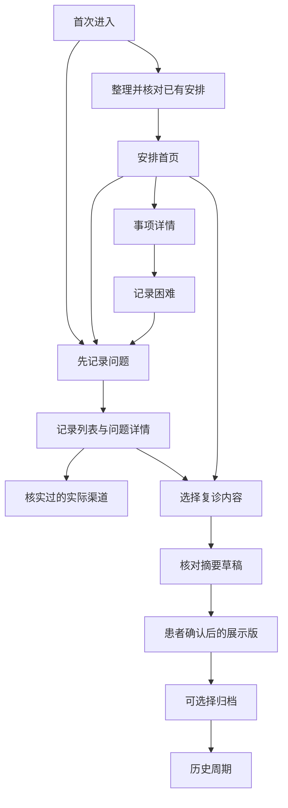
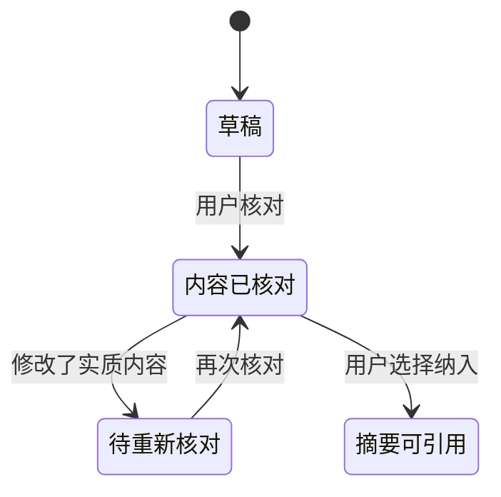

# 诊后信息与复诊沟通助手界面与交互设计原则

日期：2026年10月31日｜版本：v1.0｜对应：诊后信息与复诊沟通助手总规划 v1.0。

本文把总规划落实为可画原型、可交给 WorkBuddy 实施、可逐项检查的界面规范。文中“建议”是针对本项目的设计判断；参考产品的官方功能不代表我们具有相同的医院接入能力；线框图为合成案例的静态设计参考，不是已实现的软件或实际患者资料。

## 1 推荐结论及方案比较

推荐采用移动端优先的“任务首页＋固定导航＋可追溯的记录与摘要”。用户从已有安排进入，处理下一件事；需要时记录问题；复诊前选择、核对并展示摘要。医院场景知识体现在事项内容、记录方式和接收端信息结构中，AI 负责有限的文字整理。

| 候选结构 | 优点 | 对本项目的主要问题 | 决定 |
|---|---|---|---|
| 聊天窗口为首页 | 自由表达自然 | 下一件事藏在对话里，状态与原始依据难找，易让人期待诊疗问答 | 只把自由输入用于记录，不作为全产品主结构 |
| 健康功能大厅 | 多功能一眼可见 | 用户必须先理解模块才能办事，一周内容易堆功能 | 暂不采用九宫格大厅 |
| 单一流程向导 | 首次使用清楚 | 每次回来都重走步骤，记录与安排不便随时访问 | 仅用于首次确认和摘要核对 |
| 任务首页＋固定入口 | 现在要做什么清楚，记录和复诊准备可随时进入 | 需要设计真实状态、空页面及错误恢复 | 推荐为首版 |

核心目标：患者看得懂当前状态、找得到下一步、能纠正错误；接收者看得清哪些是患者自述、哪些尚未确认。视觉吸引力服务于这些任务。

## 2 参考方案与证据边界

以下依据为本次查阅的官方产品说明和原作者设计资料，并非安装后完整体验评测。现有产品功能只提供借鉴，不证明本项目的可用性或留存效果。

| 参考 | 核实到的设计或原则 | 借鉴到哪里 | 不照搬的部分 |
|---|---|---|---|
| Apple 健康药物功能 [1] | 从提醒进入服药记录，允许用户记录状态 | 提醒直接到对应事项，简短操作 | 系统级后台能力、强提醒和具体时间间隔不能默认适用于 Web 原型 |
| MyChart [2] | 就诊摘要、照护计划、消息与预约等围绕医疗服务组织 | 同一周期内资料复用，复诊资料集中 | 医生收件、医疗咨询、续方、实际预约与医院记录接入均不属于首版 |
| NHS 卡片与按钮规范 [3][4] | 卡片聚合相关内容和操作；主操作突出 | 下一件事卡片、清晰的主次按钮 | 不使用 NHS 品牌或暗示医院背书；临床分诊型 care card 不属于本产品 |
| NHS 错误信息规范 [5] | 解释发生什么及如何修复，保留用户输入 | 表单校验、保存失败、修改恢复 | 不照搬英文措辞，需用中文任务测试 |
| Nielsen 十项可用性原则 [6] | 状态可见、符合用户语言、可撤销、减少记忆负担 | 标签、原文就地核对、返回与纠错 | 原则是启发式，不能代替用户测试 |
| WCAG 2.2 解释文档 [7][8] | 文本对比与触控目标的可访问性要求 | 字体、颜色、按钮、键盘和辅助技术验收 | 满足单项指标不等于整体符合标准 |

参考产品很多功能已经存在。我们的候选差异化是：在一个具体诊后周期内，把来源核对、困难记录、复诊沟通及结束提醒连起来，并用目标用户和接收方反馈修正。

## 3 原则如何落实到界面

| 原则 | 本质 | 本项目的外显规则 | 检查方法 |
|---|---|---|---|
| 以任务组织 | 用户来办事，不应先学产品结构 | 首页先显示下一件事；底部使用“安排、记录、复诊” | 请用户独立找到下一步，记录是否需要解释 |
| 减少回忆负担 | 人不应靠记住另一页文字完成核对 | 草稿字段旁提供来源，摘要可就地展开原话 | 注入一条错误改写，看能否找到并纠正 |
| 状态诚实 | 软件知道的事情与现实发生的事情不同 | 已记录、已核对、本人标记完成分别显示 | 检查未回应不会成为未执行、点击联系不会成为已联系 |
| 逐步展开 | 当前只展示决策需要的信息 | 列表显示标题/时间/状态，详情展开来源与历史 | 查找主要操作时无需阅读大段材料 |
| 操作可恢复 | 人会点错，错误不应带来高成本 | 完成可撤销，修改可取消，草稿保留 | 返回、误触和失败后检查内容仍在 |
| 明确主次 | 同屏竞争太多会提高选择成本 | 每个任务页面一个主要实心按钮，其他为次级按钮或链接 | 遮住说明后能否指出主要操作 |
| AI 输出可核对 | 流畅语言不等于准确 | 草稿标识、原文对照、采用前确认、修改后重新核对 | 检查来源不明内容不会静默进入确认版 |
| 尊重个人边界 | 愿意记录不等于愿意分享 | 私人记录默认不纳入对外摘要，提供选择与预览 | 核对导出内容与选择一致 |
| 通知为任务服务 | 提醒价值来自时间与事项相关 | 用户选择提醒，点击直达事项，结束或修改后旧通知失效 | 模拟取消、改期、归档和拒绝权限 |
| 可访问性内建 | 看不清、点不中会直接导致任务失败 | 大字、高对比、文字标签、键盘操作、可放大 | 320px宽、200%缩放、键盘及读屏检查 |

以上为项目可检验的设计规则，不是已经通过测试的结论。

## 4 信息架构与导航

底部固定三个位置：安排、记录、复诊。名称、顺序、位置不随使用阶段变化。当前阶段只改变首页内容优先级，不能偷偷移动菜单。顶部提供当前周期名称及“设置与历史”。

“安排”包含首页、事项详情、创建及核对安排、提醒设置。“记录”包含记录列表、快速记录、问题详情和渠道资料。“复诊”包含内容选择、摘要核对、展示及导出。设置包含通知权限状态、暂停、历史周期、数据删除和归档。

首次未建立周期时，提供“查看合成演示”“手动整理安排”“先记一个问题”。原型不强迫登录后才能体验，也不因没有日期而禁止记录。

详情页返回原列表位置，已输入草稿保留。通知进入事项详情时提供“返回安排”。外部渠道采用明确的外链文字；返回后仍保留问题。原型中的联系人与链接必须明确区分演示资料和已核实资料。

## 5 页面规格

### S01 安排首页

用户问题：我现在有什么需要处理的？

首屏顺序：周期标题；下一件事卡；记一件事入口；待问问题与复诊准备入口。下一件事显示事项、明确日期、记录状态和来源概述，主要动作是“查看安排”。自由输入入口使用独立次级按钮，保持可见，不与主卡争抢视觉注意。

排序先采用透明的时间顺序。逾期未记录使用中性色“尚未记录”，不自动用红色或推断病情风险。复诊准备的置顶时间由用户设置或测试确定；无明确日期不显示倒计时。

没有任务时显示“目前没有已设置的待办事项”，可添加安排或记录问题。只剩待确认草稿时，显示“有一项草稿待核对”，不能把它当作正式安排。

不放健康评分、风险仪表盘、排名、连续签到、新闻推荐流或巨大 AI 头像。

### S02 整理与核对安排

用户问题：软件整理的内容是不是我实际得到的安排？

比赛版输入为合成文本或手动录入。每次聚焦一项卡片，显示“第1项/共3项”。原文与整理字段放在同一屏连续位置；手机上下排列，宽屏可双栏。重要字段的来源不隐藏在多层菜单。

字段示例：事项、日期、地点、准备事项。日期未知可选择“还不确定”；具体时间未知则不默认为午夜。来源明确说“材料中的安排”；患者回忆录入说“本人回忆记录”；不统一称为“医生已确认”。

主要动作“确认这项内容”；次级“保存待确认”；修改是字段旁文字按钮。确认完成只是内容核对，事项仍是待处理。提醒设置在下一步按需出现，不能确认内容时默认打开全部提醒。

### S03 事项详情与提醒

用户问题：具体怎么处理？我处理过了吗？

显示内容依据、时间与地点、原文、本人记录的处理状态及提醒状态。主要动作根据当前任务为“记录处理情况”；次级“有疑问”。选择完成时记录实际由用户提供的时间；允许撤销及补记。

修改事项时间与稍后通知分开命名：“修改记录中的日期”“稍后再提醒我”。取消软件事项显示清楚“仅修改这里的记录，不会取消医院预约”。

通知默认只出现最少必要内容，例如“你设置的一项安排临近”。通知不显示完整病情或药品信息。点击后到具体事项，不到首页。未获权限时显示“系统通知未开启，你仍可在这里查看安排”。

用药分支仅接受明确且用户核对过的既有安排；不显示 AI 推算剂量。用药记录可用“已记录服用”“未记录”“有疑问”，语义与实际记录一致；没有回应不能判定漏服。任何延后通知不代表调整用药时间。

### S04 记一件事

用户问题：我想把刚才的事情留下来。

固定可见的文本标签“想记下什么”，示例不充当标签。日期默认当前记录时间，事件发生时间可编辑并允许“不确定”。只要求原话，分类和去向稍后处理。

主要动作“保存记录”。保存状态只有成功写入后才显示“已保存”；失败保留输入，并提供重试/复制文本。未保存就离开时提示保留草稿或放弃，成功保存后不再弹窗阻拦退出。

记录默认不进入分享材料。保存后提供“加入复诊待问”“查看联系渠道”“仅自己保存”。这是用户自己的去向选择，不是 AI 临床紧急程度判断。工具边界与真实求助入口清楚可见，不能自动把所有担忧延迟到复诊。

### S05 问题整理与渠道

用户问题：我怎么把这件事说清楚，或找谁询问？

AI 改写采用“原话/整理建议”两块，明确标“待你核对”。主要动作“采用这段表达”，次级“保留原话”“修改”。用户可跳过 AI。若调用失败显示“这次未能整理，原话已保留”，不使用空白气泡或伪造答案。

渠道显示服务名称、用途、来源链接、核实日期、已知开放信息。没有接入医生端时用“查看官方联系信息”，不用“发送给医生”。打开链接后不自动标记已联系；是否联系与解决由用户自行记录。

### S06 记录列表

用户问题：我之前写过什么，哪些还想问？

按日期倒序，保留简短原话；筛选“全部”“待问”“仅自己”。轻量状态标签表达记录用途。条目进入详情后可编辑或移出待问，移出不删除原始记录。

记录数量少时不急于加入复杂搜索。复制到摘要引用同一记录，避免在三个模块重新输入。清空筛选时有恢复入口。图标必须带文字，不只用锁或颜色表示私人状态。

### S07 复诊内容选择与核对

用户问题：哪些内容值得这次展示，改写是否准确？

先选择内容，再生成草稿，再确认展示。摘要按“已获得的安排及处理记录”“本人记录的变化或困难”“想问的问题”组织。用户排序的是自己的沟通重点，不是临床危险等级。

默认不包含私人情绪记录；明确选择后才加入。列表可以表示“未记录”，不能写成“未出现”。本人标记事项完成，展示为本人记录，不暗示医院核实。

手机在每条摘要下展开原话，桌面左右对照。用户可直接编辑，AI 理解修改意见也只能产生新草稿。生成后有实质改动则需要重新核对。主要动作“确认并查看展示版”。没有生成或未核对的内容不显示医生审核标识。

### S08 展示版与结束本轮

用户问题：我可以把什么给对方看？这轮如何结束？

展示版以阅读为主，显示周期、本人核对时间和三段摘要；去掉底部导航、AI 输入框和无关操作，不隐藏重要的未记录信息。详细来源按需展开；“本人已核对”不等于临床审核。

展示不自动发送。导出前看预览，说明哪些资料将包含；隐私选择在生成和导出端都执行。导出后软件删除原记录不会撤回外部副本，应在相关操作时说明。

归档弹窗明确：归档软件周期，将停止哪些提醒；不表示治疗结束、不取消医院预约。选“返回检查”“归档并停止本轮提醒”。这是有后果的操作，适合确认。日常保存和完成记录则优先用撤销，避免确认疲劳。

## 6 状态模型及反馈文案

信息核对与现实任务完成是两条轴，不能放进同一枚“已确认”标签中。

| 对象 | 独立状态 | 必须避免的误解 |
|---|---|---|
| 内容依据 | 草稿待核对/本人核对过/后来有改动 | 本人核对不能显示成医生认可 |
| 事项记录 | 待处理/本人标记完成/记录了困难/用户取消 | 无记录不是未执行；取消不改变医院安排 |
| 提醒 | 未启用/已设置/被阻止/已暂停/已取消 | 未获系统权限不能显示后台提醒可靠 |
| 问题 | 已保存/待问/本人标记已联系/本人标记已解决 | 外链点击不是医生已收到 |
| 摘要 | 未生成/生成中/草稿/本人核对版本/已有新增记录 | 新信息不能静默替换旧确认版 |

以上图只表达内容状态；处理完成和提醒状态另行记录。避免实现成核对一次就自动标记事情完成。

| 场景 | 建议文案 | 应提供的动作 |
|---|---|---|
| 无日期 | 日期还不确定，可以先保存 | 保存待确认 |
| 保存失败 | 尚未保存，输入内容还在 | 重试、复制文本 |
| AI 失败 | 这次未能整理，原话已保留 | 保留原话、再次整理 |
| 部分识别失败 | 这项时间未能确定，请查看原文 | 修改、先保存 |
| 摘要过期 | 核对后又新增了记录，可重新整理 | 重新整理、查看旧版 |
| 通知失效入口 | 这项提醒已经取消，当前安排见下方 | 查看当前事项 |
| 没有待问内容 | 还没有选择要问的问题，有需要时可以记录 | 记一件事 |

错误只在需要用户修正时提示，不在刚聚焦输入框就报错。表单提交后将焦点放到错误摘要或首个错误，并保留填写内容。

## 7 视觉方向与组件

推荐“安静、清楚、有温度”的工具界面：浅背景、深色文字、单一深蓝绿主色、少量边框和留白。颜色是本项目起始方案，不具有医学效果或心理疗效含义。避免玻璃拟态、低对比灰字、大面积渐变、闪动状态、健康等级仪表和权威徽章。

| 视觉项 | 首版建议 | 理由与边界 |
|---|---|---|
| 页面背景 | #F5F7FA | 与白卡片区分，不制造视觉噪声 |
| 内容面 | #FFFFFF | 保持阅读面简单 |
| 正文 | #172B3A | 深色，便于阅读 |
| 次要文字 | #475569 | 不用极浅灰承载重要内容 |
| 主色 | #155E75 | 用于主按钮、选中导航及可操作链接 |
| 边框 | #64748B，用于需要辨识的输入边界 | 装饰分隔线可更浅，但控件边界不能只靠几乎不可见的线 |
| 待确认 | 深棕文字＋浅米色背景＋文字标签 | 不是疾病危险分级；不用颜色单独编码 |
| 错误 | #B42318＋错误文字 | 仅表达系统或输入问题，不替代临床分诊 |
| 主按钮 | 建议最小48px高，长文字允许换行 | 项目触控目标，不是声称 WCAG AA 必须48px |
| 正文 | 17px左右，行高约1.6 | 中文移动端起始值，结合目标用户验证 |
| 页面标题 | 24px左右 | 建立层级，不占据过大首屏 |
| 辅助字 | 14至15px，仍保证对比 | 不承载唯一的关键警示或操作 |
| 间距 | 8px基准，页边16至20px，卡片内16px | 保持结构一致，减少拥挤 |
| 圆角 | 12px卡片，8px按钮 | 克制一致，不用巨大胶囊容纳全部文字 |

首版通用组件：页头、底部导航、事项卡、标签、原文展开区、字段与错误、主次按钮、记录条目、保存反馈、确认对话框、联系渠道卡、摘要条目。组件必须同时规定默认、加载、选中、失败、禁用及焦点状态，不能只画默认外观。

## 8 无障碍与不同屏幕

WCAG 2.2 普通文本最低对比要求为4.5:1，大文本为3:1；AA级触控目标原则上至少24×24 CSS像素并有例外。[7][8] 本项目主要控件推荐48px高度，进一步降低点错成本，但尺寸、字号本身不构成整站合规证明。

文本放大到200%仍应可读可操作；320px窄屏避免正文横向滚动。较宽屏幕设置可读宽度，摘要核对可双栏；移动端仍是上下连续布局。底部固定按钮和键盘不能遮挡当前字段，需考虑安全区和滚动。

图标附文字，状态有文本；表单使用永久标签，不能只有占位文字。键盘可访问所有动作，焦点顺序符合阅读顺序，关闭对话框后焦点返回触发按钮。保存等状态用适当的无障碍提示，不反复打断读屏。

主要动作不依赖滑动、长按、悬停或拖拽才能发现；如支持排序，另提供上移下移按钮。动画轻量并尊重减少动态效果偏好。假设用户疲劳、手忙或视力较弱，但不以年龄标签代替实际可用性测试。

## 9 留存如何体现在界面

首次获得价值：先核对一项安排或保存一个问题，再按需请求通知权限。

过程再次使用：通知直达任务，完成后停止；快速记录入口稳定，减少每次重新找位置。一次记录可被复诊摘要引用，避免重复填写。

积累价值可见：保存后说明“已加入复诊待问”或“仅自己保存”，让用户知道记录的去向。复诊前才突出摘要，不每天催用户生成。

结束体验：没有事项时允许空白且平静；归档停止通知，保留可访问的历史；新周期来自用户新安排，不自动延续旧任务。

不设连续打卡损失、健康排名和制造焦虑的未读数。即使不打开应用也完成了任务，仍可能是好结果。通知点击率仅是过程数据，不能替代任务结果或真实依从性。

## 10 测试脚本与设计验收

用合成案例做探索性测试，建议覆盖患者使用视角与医务人员接收视角。人数有限时报告具体观察，不宣称代表所有患者。

| 任务 | 要观察什么 | 失败后优先调整 |
|---|---|---|
| 首次保存一项日期不明确的安排 | 是否误以为必须编日期 | 未知选项、说明和草稿路径 |
| 从首页找到下一件事 | 是否被众多按钮干扰 | 层级与卡片顺序 |
| 误点完成后撤销 | 是否能发现恢复操作 | 反馈、撤销和历史 |
| 记录一句担忧但不分享 | 是否理解私人状态 | 默认选择、文案和预览 |
| 查看求助渠道 | 是否误以为医生已收到 | 按钮命名与状态 |
| 找到AI摘要中的错误 | 是否能看原话并修改 | 原文位置、逐条核对 |
| 生成后又新增记录 | 是否发现旧摘要不是最新 | 版本提示与重新核对 |
| 关闭提醒或归档 | 是否理解只影响软件 | 确认文案与通知清理 |
| 手机键盘输入与200%缩放 | 是否被底部按钮遮挡 | 布局和滚动 |
| 接收者快速浏览展示版 | 能否找到关心的信息 | 分组、长度、患者问题排序 |

阻断交付的错误包括：擅自新增医疗安排、把未记录变成正常、私人记录未经选择被分享、旧提醒在归档后继续触发、导航误示医生回复、输入丢失、关键操作无法完成。测试发现为零不意味着长期安全有效，只是本轮版本验收。

## 11 一周实施与交接给 WorkBuddy

第一步画 S01、S02、S04、S07 四个关键页面，确认任务关系。第二步以合成数据串起来源核对、记录、摘要、归档，不依赖模型也能演示。第三步接入有限 AI 整理并补失败恢复。第四步验证真实通知；若只有模拟，明确标注。最后做字体、触控、键盘、长文字及接收端试读。

开发交接要求：三个稳定导航；每个任务页面一个主要动作；内容/执行/通知分开建模；草稿与原话不能被AI覆盖；所有私密记录纳入摘要需明确选择；不建立虚假的医院端；真实后台提醒未完成时不宣称完成；主体开发使用 WorkBuddy。

暂缓家属账户、语音、复杂图表、自动风险判断、医疗内容推荐流、医生在线聊天。家属功能尤其需要独立权限设计，不能为了留存直接共享未回应记录。

## 12 需要团队决定的项目

具体科室和人群；病程或诊后周期长度；实际接收方是谁；当前最主要断点；日期和安排来源；用户愿意输入多少内容；所选平台能否可靠通知；真实渠道如何核实；一周内主亮点做深在哪一页。

你负责信息架构、页面优先级和测试组织；两位医学生补充实际场景、合成材料、措辞及接收者意见；相关医务人员帮助确认流程和内容边界。用户需求仍需患者视角验证，不能仅凭医学生经验推断。

## 13 配套视觉参考

同目录的《六屏界面参考_v1.0.png》展示六个合成页面：安排首页、安排核对、快速记录、问题整理、摘要核对、展示与归档。图片用于讨论信息层级和方向；不是可交互软件，不能据其证明响应式、读屏、推送或临床功能已实现。长列表、错误、空状态和其他分支以本文为准。

## 14 来源

以下为功能与原则依据。尺寸、配色、页面名称、状态划分和实施优先级是本项目建议。

1. Apple 药物记录官方帮助：https://support.apple.com/en-au/105064 （本次已有官方搜索内容；直接打开遇限流，未据此推断更多功能）
2. MyChart 官方功能：https://www.mychart.org/l/en-us/explore/
3. NHS 卡片：https://service-manual.nhs.uk/design-system/components/card
4. NHS 按钮：https://service-manual.nhs.uk/design-system/components/buttons
5. NHS 错误反馈：https://service-manual.nhs.uk/design-system/components/error-message
6. Nielsen 十项可用性原则：https://www.nngroup.com/articles/ten-usability-heuristics/
7. W3C 文本对比：https://www.w3.org/WAI/WCAG22/Understanding/contrast-minimum.html
8. W3C 控件最小尺寸：https://www.w3.org/WAI/WCAG22/Understanding/target-size-minimum.html

本次日期为2026年10月31日。原始来源用于设计参考，不能视为对本作品的临床认证、效果验证或医院合作证明。
