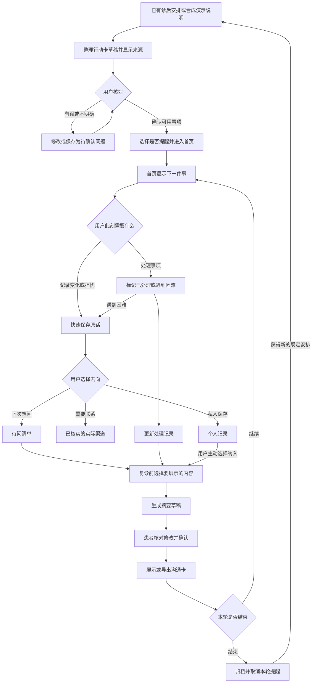

# 诊后信息与复诊沟通助手总规划

版本：v1.0｜日期：2026年10月31日｜用途：团队选题讨论、需求验证、WorkBuddy 主体开发与比赛展示。

本规划整合团队已有《项目总规划.docx》和讨论中的设计建议。它是一份待验证的产品方案，不代表需求、临床价值或长期留存已经得到证明。原始 Word 文档保留，后续变化通过新版本记录。

## 1 产品结论与核心理念

围绕一次就诊结束到下一次复诊的过程，帮助患者落实已有安排、保存疑问，并在复诊前整理好要沟通的信息。产品只在有明确任务或用户主动需要时出现；这一轮任务结束，就停止打扰。

产品包含三个相互连接的模块：诊后行动卡、疑问与关怀导航、复诊沟通桥。完整覆盖一个具体诊后周期，选择其中一个最有证据的断点做深。全面指前后能连接，不代表同时覆盖所有疾病、科室和人群。

暂定一句话介绍：面向有后续复诊安排的门诊患者，把已获得的安排整理成行动卡，帮助保存诊后变化与疑问，并在复诊前生成由本人核对的沟通摘要。

“门诊患者”是当前范围建议，尚未确定具体科室。若团队主要能接触某类出院后流程，可以调整，但三个模块必须始终服务同一人群、同一段经历。

## 2 已确定约束与尚未确定的事

| 类型 | 内容 | 对决策的影响 |
|---|---|---|
| 比赛规则 | 开发期一周；只归属一个赛题 | 暂归赛题2健康管理与身心关怀；限定完整主路径 |
| 比赛规则 | WorkBuddy 完成主体开发，其他 AI 工具辅助 | 本文用于产品规划；实施和开发记录按赛事要求保留 |
| 比赛红线 | 不输出诊断结论，不给出用药方案，不替代专业意见 | AI 只整理、改写和归类既有信息；不判断疾病或调整治疗 |
| 数据边界 | 禁止真实患者数据及未脱敏敏感资料 | 原型、模型调用、演示使用合成案例或许可适用的公开材料；本项目默认合成数据 |
| 交付规则 | 四份材料按群内《提交材料说明.md》准备 | 文件尚未取得，材料具体名称、格式和打包方式不能自行假定 |
| 当前未知 | 具体科室、人群、诊后周期及真实主要困难 | 首轮访谈后决定，不当作已经验证 |
| 当前未知 | 工程能力、可用 API、预算、提醒运行环境 | 设计通知抽象和演示触发器，实际推送能力单独验证 |
| 当前未知 | 医务人员审阅与试用资源 | 两位医学生的观察提供线索，不能替代目标用户和接收方反馈 |

产品输入中的“用户确认”仅表示用户认可该记录，不表示医生已经审核，也不保证临床正确。

## 3 用户与问题本质

### 3.1 优先服务对象

建议先服务能独立使用手机、已获得明确后续安排、预计还要复诊或随访的成人用户。患者是主要使用者，接诊或随访人员是摘要接收者；家属协作作为后续选项，不作为第一版必需条件。

优先选择团队能找到相关经历者和医务人员反馈的场景，而不是先选择最复杂、听起来最专业的疾病。没有后续安排的人也可以保存问题，但不属于首版留存指标的核心人群。

### 3.2 三个待验证断点

1. 理解到执行：医生说过的事项回到生活中可能不够清楚，或时间、地点、准备材料分散。
2. 执行到表达：患者出现困难或担忧，但当时没有方便记录，或者不知道如何向合适的人表达。
3. 记录到沟通：复诊时难以回忆过程，已有记录太散或太长，接收方不方便阅读。

这三项是问题假设。还要比较患者现有办法，例如纸质说明、手机日历、医院应用、家属提醒和直接联系原服务渠道。如果已有办法足够好，产品必须缩小或改变切口。

### 3.3 产品价值假设

若特定患者在上述过程中确有信息理解和沟通困难，且产品减少了整理与回忆的负担，同时不会引入错误或额外负担，那么患者会在事项临近、有疑问和复诊准备时使用它。

反证包括：用户不愿输入；信息来源不足；提醒没有帮助；摘要增加医务人员阅读负担；用户误以为软件在诊断或医院已收到消息。出现反证时修改相应机制，不通过增加功能掩盖问题。

## 4 全程流程图



进入导航页不意味着问题已被医务人员接收。提醒不意味着已预约。患者标记完成不等于系统核实了现实行为。产品必须保留这些区别。

## 5 页面结构与三个模块

底部导航建议为“当前安排”“我的记录”“复诊准备”。设置、历史周期和数据管理放在个人入口。首页显示当前最相关的动作，避免把三个模块变成三个需要用户理解的专业名称。

### 5.1 首次进入与行动卡创建

目的：先交付一个立即有用的结果，并建立可信输入。

页面标题为“把接下来的安排整理清楚”。比赛版提供合成案例选择和手动输入。AI 从明确提供的材料生成草稿，保留原文位置。识别不清的信息显示“待确认”，不能默认补全。

每张卡包含事项名称、来源原文、用户确认的时间与地点、原说明已有的准备事项、状态及提醒偏好。每项可确认、修改、删除。只有经用户确认的事项才能创建对应提醒。未确认事项允许保存，不强迫用户把不知道的内容填成确定答案。

首次设置只要求完成最必要的信息。提醒权限在用户选择具体提醒时申请；拒绝权限不妨碍记录和摘要功能。先展示价值，再请求额外权限。

### 5.2 首页与事项详情

首页最显眼的两张卡为“下一件事”和“有事想记下或问清”。另显示待问问题数量与进入复诊准备的入口。这里的数量只能来自实际记录，不能制造紧迫感。

```
下一件事：已确认的复诊安排
时间与地点：用户确认的信息
[查看详情] [我遇到困难了]

有事想记下或问清？
[记一件事]

待问问题 2项       [查看]
复诊准备           [整理]
```

无事项时显示“目前没有需要处理的安排，有疑问时可以随时记下”。不创建虚假的日常健康任务。时间未知时，不显示倒计时。

详情页提供“标记已处理”“需要再确认”“暂不处理”和“查看来源”。时间修改与通知稍后提醒是两个动作：推迟通知不改变实际安排。

### 5.3 疑问与关怀导航

目的：把不确定和担忧变成可保存、可表达的问题，并提供实际可用的渠道。

用户先输入一句原话，默认保存原话和时间；语音输入是可选增强项。保存后由用户选择“留待复诊时问”“查看联系渠道”“仅自己保存”。不强迫每条记录进行多轮 AI 对话。

AI 可提出一条清晰问句，例如把“那个复查没听清”整理成“我想确认上次提到的复查安排和需要准备的材料”。显示原话与建议，提供采用、修改、保留原话。不能在改写时自行给出复查项目、疾病解释或治疗建议。

问题状态为“已保存”“准备询问”“用户标记已联系”“用户标记已解决”。点击联系入口只能记录打开动作，不能自动变成已联系或已解决。

渠道卡包含官方名称、服务用途、适用范围、开放时间（有依据时）、官方链接及核实日期。信息缺失则明确显示未核实，不伪造医院在线客服或医生回复。

心理关怀首版包含私人感受记录、问题整理和经过核实的支持资源导航。私人记录默认不进入对外摘要。产品不作心理诊断或提供治疗，也不能把需要现实帮助的问题自动延后到复诊。界面说明本工具不是急救或实时医疗服务；求助入口按所在地和官方资料另外核实。

### 5.4 复诊沟通桥

目的：让此前积累的信息形成实际沟通材料。

入口始终可见，临近用户确认的复诊日期时才突出。无日期时不自行推定复诊时间。草稿按“安排处理情况”“本人记录的变化与困难”“待问问题”组织。

患者选择纳入哪些记录、按自己的需求排序问题、查看来源并逐项修改。重点排序表达的是患者想先谈什么，不表示医学风险级别。

核对安排在复诊之前；诊室里仍可修改。AI 改写后的版本需要重新确认。已确认版本注明生成与确认时间；新记录出现后提示摘要已不是最新，不静默改写已确认内容。

输出优先为一页可读页面，提供打印或导出作为增强项。呈现“患者自述”“未记录”“用户标记完成”，不写“疾病已排除”“病情稳定”或未经依据的趋势结论。来源详细内容可展开，避免医生先读冗长原始记录。

接收端是否愿意查看仍须验证。没有医院系统接口时，页面明确由患者自行展示，不显示“医生已阅”。

### 5.5 结束与下一轮

用户可结束本轮、暂停提醒、查看历史或删除记录。归档仅结束软件任务周期，不表示治愈，也不指示停药。归档前说明哪些软件提醒将停止，并由用户确认。

获得新的专业安排后，用户开启新周期；历史待问问题只能由用户选择带入。旧用药或复诊事项不得自动延续为新安排。

## 6 留存理念与外显机制

留存单位是一个有实际任务的诊后周期。目标是在合适时机完成真实任务，而非每天打开或延长聊天时间。患者通过通知完成记录，即使没进入首页，也可能是成功使用。

| 触发 | 放置位置 | 用户动作 | 即时价值 | 结束条件 |
|---|---|---|---|---|
| 首次拥有安排 | 创建页 | 核对一张行动卡 | 看清下一件事 | 确认或保存待确认项 |
| 已确认事项临近 | 用户允许的通知与首页 | 查看、标记、记录困难 | 少一次寻找和回忆 | 已处理、取消或本轮归档 |
| 想到疑问 | 首页及事项页固定入口 | 一句话记录 | 问题不丢失 | 保存后即可退出 |
| 需要真实联系 | 问题详情页 | 查看核实渠道 | 知道如何表达与联系 | 用户自行决定，不追踪施压 |
| 准备复诊 | 首页与复诊准备页 | 整理核对摘要 | 之前记录可以用于沟通 | 摘要确认，或用户关闭提醒 |
| 本轮完成 | 周期结束页 | 归档 | 旧任务与通知清理 | 停止本轮全部提醒 |

### 6.1 通知具体规则

每条通知必须关联一个经用户确认的事项或自选的复诊准备动作。用户选择时间、渠道及是否需要再次提示；初版默认不无限重发。未回应显示未记录，不判定患者没有执行。

通知示例：“你设置的一项复诊安排临近，查看时间与准备事项。”点击直接到对应卡片。锁屏不暴露不必要的健康细节。已确认完成、取消、归档后对应通知失效；用户修改安排后同步替换旧通知。提供明显的关闭和撤销入口。

若做用药提醒，只复现已明确、已确认的安排；用户未记录时不得推断漏服，更不能生成补服指导。按需用药或时间不明确的合成案例，不自动创建固定服药计划。延后通知不代表建议延后服药。

### 6.2 真实推送与演示的区别

浏览器页面中的计时提示不保证应用关闭后仍能提醒。实际推送受平台权限、后台运行和网络影响。一周内先保证可操作的主流程，再验证目标平台通知。若仅完成模拟通知，演示按钮标注“模拟事项到期”，比赛说明诚实写明尚未实现后台可靠提醒。

### 6.3 不采用的留存方式

首版不加入健康排名、连续签到惩罚、制造焦虑的未读红点、无任务的每日催促、无限陪聊或默认家属监督。用户可自由跳过、关闭和退出。本轮完成后不为了活跃度制造新的健康事项。

## 7 参考产品及可借鉴范围

| 产品 | 已公开的设计 | 本项目借鉴 | 不直接复制的条件 |
|---|---|---|---|
| Apple 健康药物功能 | 从提醒记录状态、可选后续提醒 | 通知直达一个明确动作，允许不记录 | 系统级后台能力与具体提醒间隔不能直接当作本项目已实现 |
| Medisafe | 用户邀请家人协助、查看相关提醒 | 协助必须可选择且有权限边界 | 家属共享不是首版必需；不把未记录直接当漏服 |
| MyChart | 就诊后摘要、照护计划和医疗机构消息 | 信息在同一周期连续复用 | 医院系统接入、医生收件与回复不能假设存在 |
| NHS App | 预约、文件与消息等事件触发通知 | 一条消息对应真实事项和下一步 | 预约确认、改约、续方等需真实服务接入 |

这些是功能参考，不是这些机制已经证明本项目留存有效的证据。已有软件具备提醒、摘要或 AI 改写，因此不能把单个功能本身宣称为独有创新。

## 8 AI 的位置与最小技术安排

### 8.1 可以交给 AI 的任务

将合成诊后说明中的明确内容整理成行动卡草稿；把用户自由描述改写为问题；把用户选中的记录整理成复诊摘要。每项输出保留来源，并经过用户确认。

### 8.2 不能交给 AI 的任务

判断患病或排除疾病；调整药物与治疗；自行判断症状是否安全、是否可以等到复诊；编造医院联系方式；把缺失内容补成否定事实；把个人担忧当诊断结论。

### 8.3 实施建议

WorkBuddy 完成主体开发。首版可做移动端优先 Web 原型，核心表单、记录、状态和摘要核对应在模型不可用时仍能运行。AI 是可替换的整理能力，调用失败保留原文并允许手动编辑；演示预设结果须明确标识，不能伪装实时生成。

若调用外部 API，密钥放服务端或受保护环境，不能放前端代码；模型费用与开发工具订阅分开核实。配置调用次数、预算和输出长度限制。用合成案例测试后选模型，不提前购买大量资源。

最小数据结构包括：周期、原始材料、行动卡、记录、待问问题、渠道、摘要版本、提醒设置。每条内容保存来源类型、时间、用户确认状态及所属周期。摘要是记录的一个版本，不覆盖原始内容。

敏感文本不写进产品分析日志；分析只记录完成动作和错误类型。测试者用合成案例，不要求上传本人病历或披露诊断。提供删除测试记录的方式。

## 9 真实调研与证据管理

患者需求不能只由团队想象或医学生观察代替。第一轮建议少量相关经历者与至少一位熟悉目标流程的医务人员参与，这是探索安排，不是统计代表性样本。

访谈只了解过程与工具，不收集病历、处方、诊断或可识别个人的敏感资料。让参与者使用合成案例试用；匿名记录流程困难和反馈，不开展真实诊疗试验。

患者侧问题：上次离开医院后靠什么记住安排？哪件事需要回头确认？当时用什么方式解决？复诊前如何回忆经历？哪些信息不愿被家属或他人看到？

接收侧问题：复诊时最先需要哪些类型的信息？患者常在哪些地方讲不清？一页摘要最该保留什么？已有医院服务已经解决了什么？什么表述会被误认为临床结论？

每条发现记录：匿名角色、场景、亲历/观察/推测、现有办法、具体困难、对应设计、反例和下一验证动作。外部论文只能提供问题线索，不能代替本地需求证据。

## 10 三人分工与讨论产物

| 角色 | 主要工作 | 需要交付的产物 |
|---|---|---|
| 你 | 产品目标、访谈组织、范围取舍、页面流程、验收、开发协调、展示叙事 | 一页问题定义、流程图、页面清单、决策记录、测试结果 |
| 医学生甲 | 目标场景梳理、材料出处、合成案例、专业措辞检查 | 场景地图、3至5个合成测试案例、来源表、需专业复核的问题 |
| 医学生乙 | 患者及接收者接触、访谈与试用协助、渠道核实 | 匿名反馈、接收端摘要意见、渠道表和核实日期 |
| 外部医务人员如可获得 | 对目标流程、演示内容和摘要可用性提供意见 | 对具体材料的反馈；不宣称全面认证 |

分工按实际技能调整。两位医学生也参与产品决定，你负责推动证据和取舍一致；医学学历不代替实际场景经验。开发负责人、每天投入时长和 WorkBuddy 使用方式需在首次团队会上明确。

第一次会议建议依次回答：服务谁；从哪一步到哪一步；现在的替代办法；最有证据的断点；三个模块如何连接；主亮点；可访问的用户和审阅者；工程资源；首版范围。产出明确决定、负责人、未解决问题和下一验证日期。

## 11 首版优先级与一周安排

必须完成：合成案例输入、来源与确认、行动卡状态、快速记录、问题去向、可核对摘要、周期归档。三个模块共用同一组资料，不能重复录入。

条件完成：至少一种实际通知或明确标识的通知模拟；核实渠道卡；摘要打印或导出。

可延后：真实处方识别、语音识别、家属协作、跨机构数据同步、医生工作台、开放式医疗问答。延期不是删除长期方向，而是避免一周资源被集成依赖消耗。

| 时间 | 目标 | 当天可检查结果 |
|---|---|---|
| 第1天 | 核实规则、讨论人群、首轮访谈与资源 | 问题定义、证据缺口、候选场景 |
| 第2天 | 选断点、确定主亮点、画页面、审阅合成案例 | 可操作低保真流程、核心测试案例 |
| 第3至4天 | WorkBuddy 主体开发，串通完整过程 | 不依赖模型也能完成记录与核对的版本 |
| 第5天 | 用户完成任务，接收者试读摘要 | 错误与负担记录、需要修正的主问题 |
| 第6天 | 修复关键问题、检查通知生命周期和边界 | 验收记录、可靠演示路径 |
| 第7天 | 打包材料、录制演示、核对命名规则 | 四份规定材料及可运行作品 |

若前两天无法接触目标用户，把需求标为未验证，保留演示范围并减少健康效果主张。若主要失败是输入过重，优先简化输入；若摘要无人愿意看，重选接收形式或调整主亮点。不得在失败后自动扩大功能。

## 12 验证与验收

### 12.1 功能与可靠性

- 含明确时间的案例能提取草稿并经用户确认；时间缺失时不生成日期或倒计时。
- 用户修改安排后旧提醒取消；完成、关闭、归档均停止相应提醒。
- 关闭或推迟通知不会改写实际就诊/服药安排。
- 未回应保持未记录，不输出漏服、未就诊等未经证实的结论。
- AI 故意产生一条无来源内容时，流程允许发现、删除和纠正；不得把一次核对视为模型可靠性证明。
- 用户改写摘要后需重新确认；原话可追溯；无记录不能写成正常或不存在。
- 私人情绪记录未经选择不进入导出；导航点击不显示医生已收到。
- 模型失败和网络失败时不丢失原文，不展示伪造结果。
- 归档不呈现医疗任务结束或停药建议；新周期不自动沿用旧安排。

### 12.2 用户任务测试

用合成案例让参与者完成：首次确认事项；收到模拟到期提醒后处理；记录一个模糊疑问；核对存在改写错误的摘要；归档并检查旧提醒停止。记录独立完成与否、所需提示、误解位置、耗时、修改次数和不想要的提醒。

接收者在有限时间内查看摘要，指出能否快速找到本轮安排、患者自述变化和待问问题。其主观喜欢不等于真实临床效果；反馈具体落实到删减和结构调整。

### 12.3 留存指标的正确定义

首次激活：进入者中完成至少一张行动卡确认或一条问题记录的人数。任务回访：具有实际到期任务的周期中，发生查看/处理/记录困难的周期数；无到期任务的人不进入该分母。复诊准备：有用户确认复诊日期的周期中，患者核对摘要的比例。使用摘要和真正接受诊疗分别记录，不混为同一事件。

少量试用报告原始人数与任务表现，不用精确百分比制造确定性。重复测试同一人或同一案例不能当作独立用户增加样本。模拟时间只验证流程，不能证明长期留存。健康结果改善、减少漏诊或降低再入院均不属于本轮可证明结论。

## 13 演示叙事与团队亮点

用一个合成角色走一条完整路径：离院后确认安排；中途事项临近；遇到疑问并记录；复诊前整理并发现一处 AI 改写不准确；患者纠正；展示摘要；归档取消旧提醒。

产品亮点：任务决定出现时机，记录自然流向沟通，用户可以核对与退出。

医学场景亮点：具体人群的真实流程、专业语言边界、接收者实际需要的信息。实习经验是形成假设的资源，不宣称已覆盖全部临床工作。

证据亮点：展示哪条用户反馈改变了哪处设计，并保留未解决问题。不得把演示角色或预设案例当真实用户故事，也不虚构医生背书。

## 14 与原规划相比需要明确的调整

1. “做全做深”落实为三个环节接通、一处断点做深。
2. “患者需求可自己思考”调整为团队先提出假设，再由真实经历和合成任务测试验证。
3. “AI 自动根据处方提醒”调整为提取草稿、来源可见、用户核对、再设置提醒。
4. “模糊入口”具体化为记一件事的自由输入，保留明确去向；不是无边界医疗聊天。
5. “医生让患者核对摘要”前移到复诊前由患者主动核对，诊室中保留修改能力。
6. “AI 分析给医生看”限定为整理用户记录和已有安排，不生成新的医学判断。
7. 留存从末尾独立章节落实到首次进入、首页、通知、快速记录、复诊准备和归档六处。

## 15 参考资料

以下资料用于了解现有产品与问题背景，不能证明本项目需求或效果。功能信息依据2026年10月31日前本次讨论中的官方查询。

- Apple 药物添加、记录与提醒：https://support.apple.com/en-au/105064
- Medisafe 家属协助功能：https://help-center.medisafe.com/en/articles/8097801-what-is-a-medfriend-and-how-does-the-feature-work
- MyChart 官方功能：https://www.mychart.org/l/en-us/explore/
- NHS App 医院预约：https://digital.nhs.uk/services/nhs-app/nhs-app-features/hospital-referrals-and-appointments-in-the-nhs-app
- NHS App 消息边界：https://www.nhs.uk/nhs-app/help/messages/
- 诊后短信项目需求研究：https://shmpublications.onlinelibrary.wiley.com/doi/10.1002/jhm.13466
- 提醒装置随机试验，显示单靠提醒未必有效：https://pubmed.ncbi.nlm.nih.gov/28241271/

下一次版本更新应补：具体人群与科室、真实访谈发现、主亮点选择、正式提交说明、工程负责人、实际提醒能力及测试结果。
